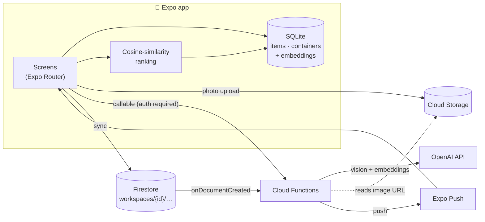

# SCIM

**Snap a photo of anything you own, then find it later by describing it.**

SCIM is a mobile home-inventory app built with React Native (Expo) and Firebase. You photograph items and the boxes, drawers, and shelves they live in. SCIM uses a vision model to describe each photo and stores a vector embedding of that description, so searching for "the blue extension cord" or pointing the camera at a similar object finds the right item even if you never typed its name.


<!-- Add 2–4 screenshots or a short GIF to docs/screenshots/ and uncomment:
<p align="center">
  
  
  
</p>
-->

## Features

- **Photo-first capture**: create items and containers straight from the camera
- **Semantic search by text or image**: matches on meaning, not exact keywords
- **AI enrichment**: auto-generated descriptions for every photo
- **Local-first storage**: everything works offline in on-device SQLite
- **Cloud sync**: back up and restore your inventory with Firestore and Cloud Storage
- **Push notifications** when items or containers are added to your workspace
- **Accounts**: email/password auth with a persistent session, plus profile and notification settings
- **Shared households (in progress)**: create or join a group with an invite code; role-based access is already enforced in the security rules

## Architecture



### How search works

1. When you save an item, the photo is uploaded to a private, per-user folder, and a Cloud Function asks a vision model (`gpt-4.1-mini`) for a search-oriented description of it.
2. That description is embedded with `text-embedding-3-small`, and the vector is stored next to the item in SQLite.
3. **Text search** embeds your query. **Image search** describes and embeds the photo you take or pick.
4. The query vector is ranked against every stored vector with cosine similarity on the device (`components/vectorSearch.ts`).

At the size of a personal inventory, brute-force ranking on the device is fast. It avoids a vector database, works offline once the embeddings exist, and keeps the ranking logic small enough to unit-test.

### Security design

- **No API keys in the app.** The OpenAI key lives in Google Secret Manager and is only read inside Cloud Functions (`defineSecret`).
- **Authenticated AI endpoints.** Every callable rejects unauthenticated requests and validates its input, so the project can't be used as a free OpenAI proxy.
- **Workspace-scoped data.** Firestore and Storage rules restrict each `workspaces/{id}` tree to its owner, or to group members with `owner`, `admin`, or `member` roles. Only owners can delete shared data.
- **Scoped notifications.** Push notifications only go to members of the workspace where the change happened.

> The Firebase web config in `firebase.ts` is meant to be public. Firebase protects data with the security rules above, not by hiding that config.

## Tech stack

| Layer | Tools |
| --- | --- |
| App | Expo SDK 54, React Native 0.81, React 19, TypeScript, Expo Router (typed routes) |
| Device | expo-camera, expo-image-picker, expo-image-manipulator, expo-sqlite, expo-file-system, expo-notifications |
| Backend | Firebase Auth, Cloud Firestore, Cloud Storage, Cloud Functions (2nd gen, Node) |
| AI | OpenAI Responses API (vision), Embeddings API |
| Quality | TypeScript strict mode, ESLint, Node test runner, GitHub Actions CI |

## Project structure

```
app/                  Screens (file-based routing)
  (tabs)/             Home/search, Storage, Sync, Profile
  item/, container/   Create, view, edit flows
components/
  database.ts         SQLite schema, migrations, queries
  vectorSearch.ts     Embedding parsing + cosine-similarity ranking (pure, tested)
  cloudDatabase.ts    Firestore/Storage sync
  aiTools.ts          Client wrappers for the AI Cloud Functions
  manage.ts           Delete flows that clean up local + cloud copies
functions/src/        Cloud Functions (AI proxy, push notifications)
firestore.rules       Firestore security rules
storage.rules         Storage security rules
tests/                Unit tests
```

## Getting started

### Prerequisites

- Node 22+
- A Firebase project with Auth (email/password), Firestore, Storage, and Functions enabled (Functions requires the Blaze plan)
- An OpenAI API key
- An Android/iOS device or emulator. SCIM uses native modules, so build a [development client](https://docs.expo.dev/develop/development-builds/introduction/) instead of using Expo Go.

### Run the app

```bash
npm install
npx expo run:android   # or: npx expo run:ios
```

To point the app at your own Firebase project, replace the config in `firebase.ts` and `google-services.json`.

### Deploy the backend

```bash
npm install -g firebase-tools
firebase login
firebase use <your-project-id>

firebase functions:secrets:set OPENAI_API_KEY
(cd functions && npm install)
firebase deploy --only functions,firestore:rules,storage
```

## Testing

```bash
npm test            # unit tests (Node's built-in test runner)
npm run typecheck   # TypeScript
npm run lint        # ESLint
```

CI runs all three, plus the Cloud Functions lint and build, on every push and pull request.

## Roadmap

- [ ] Two-way sync for edits and deletes (today, sync only pushes and pulls missing records)
- [ ] Finish shared households end-to-end (join flow and syncing into the group workspace)
- [ ] Clean up temporary AI uploads automatically with a Storage lifecycle rule
- [ ] Firebase App Check on the AI callables
- [ ] Component tests for the main capture and search flows

## License

[MIT](LICENSE)
