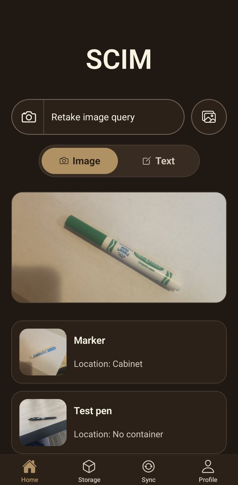
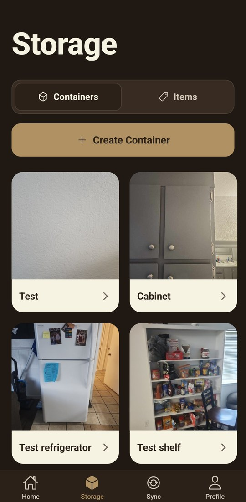
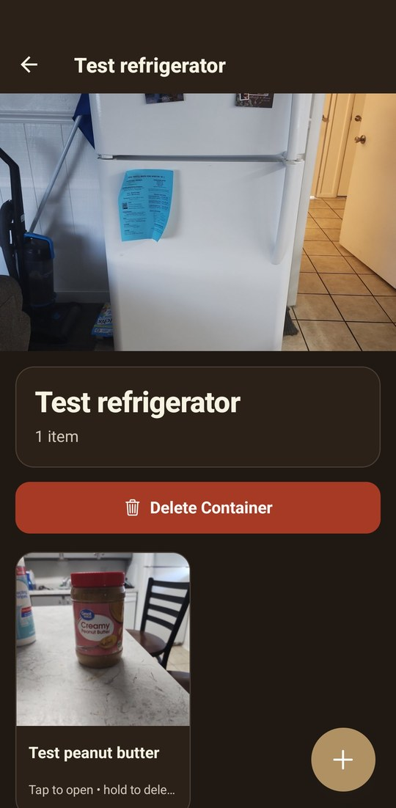
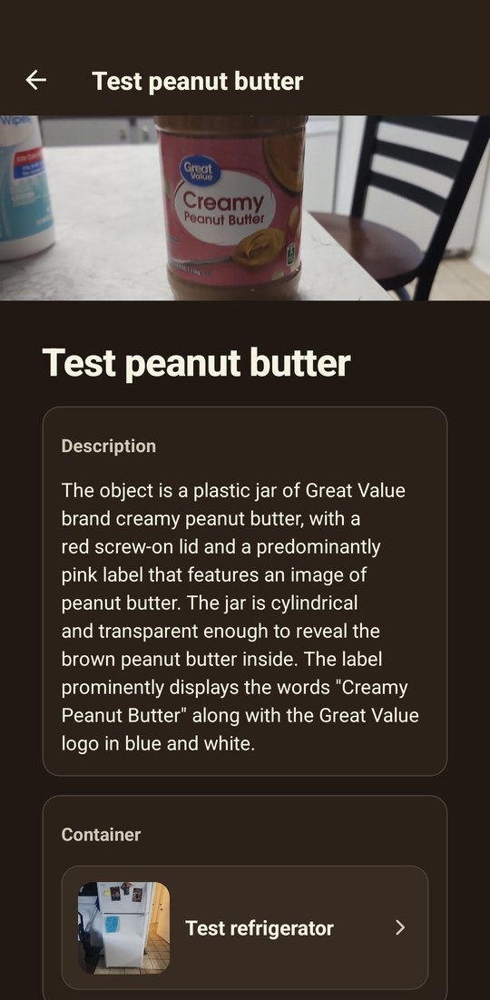
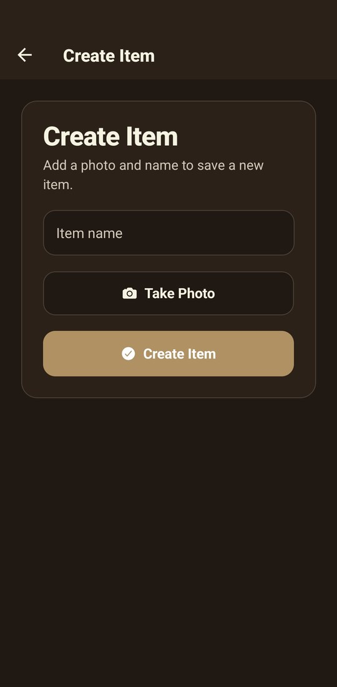
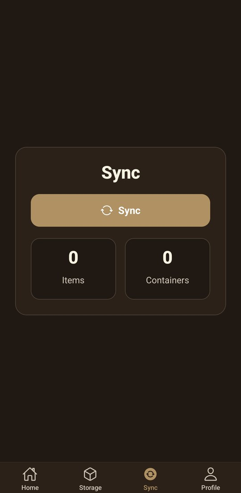
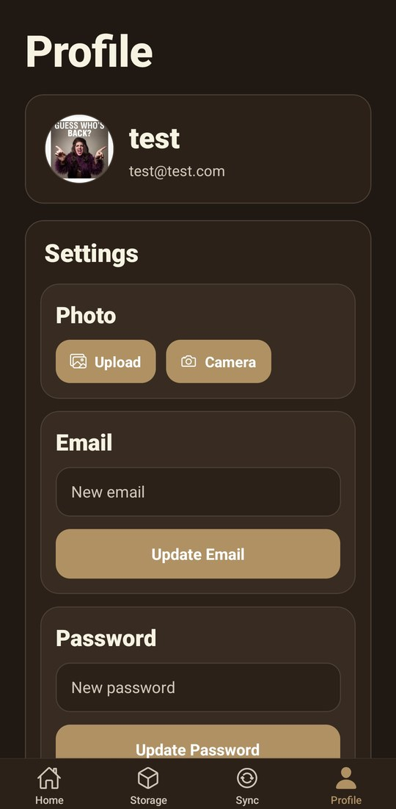

# SCIM

**SCIM** is a mobile inventory app built with **Expo / React Native** for tracking containers and items with photos, AI-powered semantic search, local-first storage, and Firebase cloud sync.

The current project focuses on making home or personal inventory easier to capture and find later:
- take a photo of an item or container
- save it locally on the device
- enrich it with AI-generated descriptions and embeddings
- search by text or image similarity
- sync missing data to Firebase
- receive push notifications when new items or containers are added in the cloud

---

## Screenshots

<table>
  <tr>
    <td align="center" valign="top">
       
      <b>Search by photo</b> Snap an item to find similar saved items and where they're stored
    </td>
    <td align="center" valign="top">
       
      <b>Storage</b> Containers, each with its own photo
    </td>
    <td align="center" valign="top">
       
      <b>Container</b> Everything stored inside it
    </td>
    <td align="center" valign="top">
       
      <b>Item details</b> AI-generated description and linked container
    </td>
  </tr>
  <tr>
    <td align="center" valign="top">
       
      <b>Add an item</b> Name it and take a photo
    </td>
    <td align="center" valign="top">
       
      <b>Sync</b> Push and pull inventory with Firebase
    </td>
    <td align="center" valign="top">
       
      <b>Profile</b> Photo, email and password settings
    </td>
    <td></td>
  </tr>
</table>

---

## What the app does

### Core features
- **Email/password authentication** with Firebase Auth
- **Local-first inventory storage** using SQLite
- **Create containers and items** with camera photos
- **Semantic search** using either:
  - text queries
  - image queries from camera or gallery
- **AI enrichment** for item descriptions and embeddings
- **Cloud sync** between local SQLite data and Firebase
- **Push notifications** for newly created cloud items and containers
- **Profile settings** for account changes and notification preferences

### Current behavior
- Sync currently handles **missing-record push/pull only**
- Sync **does not merge edits or deletes yet**
- Loose items are visually separated from items already placed in a container
- Group creation / join UI appears to be in progress and is not yet a documented end-to-end feature

---

## Tech stack

### Frontend
- Expo SDK 54
- React Native 0.81
- React 19
- Expo Router
- TypeScript

### Device / mobile features
- `expo-camera`
- `expo-image-picker`
- `expo-file-system`
- `expo-sqlite`
- `expo-notifications`

### Backend / cloud
- Firebase Authentication
- Cloud Firestore
- Firebase Storage
- Firebase Cloud Functions (2nd gen APIs)
- OpenAI API for descriptions and embeddings

---

## How search works

SCIM uses embeddings to make inventory search more flexible than exact keyword matching.

### Text search
A text query is converted into an embedding, then compared against stored item embeddings using cosine similarity.

### Image search
A captured or selected image is described by AI, converted into an embedding, and matched against saved items.

This lets users find objects even when they do not remember the exact item name.

---

## Local data model

The app stores data locally in SQLite using two main tables:
- `containers`
- `items`

Items store:
- name
- description
- image URI
- container relationship
- embedding
- tags
- cloud sync metadata
- timestamps

Containers store:
- name
- image URI
- embedding
- cloud sync metadata
- timestamps

---

